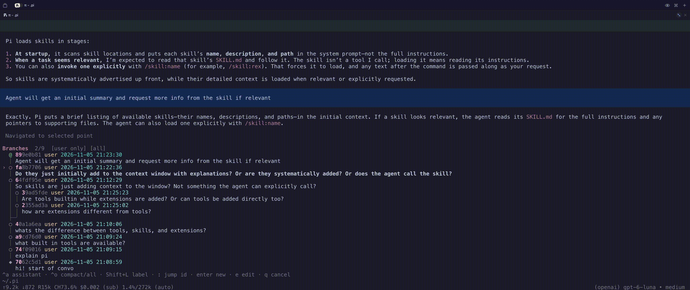

# pi-jjtree

A jj-style conversation tree navigator for Pi. 

This navigates **Pi conversation history**, not repository history. The `jj` CLI is not required.

## Install

```sh
pi install git:github.com/NolanFogarty/pi-jjtree
```

Run `/reload` in an existing Pi session after installation. 

## Usage

```text
/jj-tree
```

| Key | Action |
| --- | --- |
| `j` / `k`, Down / Up | Move between rows |
| `h` / `l`, Left / Right | Jump to the newest row in an adjacent branch column |
| `g` / `Shift+G` | First / last row |
| `Ctrl+D` / `Ctrl+U` | Half-page down / up |
| `Ctrl+F` / `Ctrl+B` | Page down / up |
| `Ctrl+A` | Toggle assistant messages |
| `Ctrl+O` | Toggle compact view |
| `Shift+L` | Set a label; submit an empty label to remove it |
| `:` | Jump to a unique message ID prefix |
| Enter | Continue from the selected message, or expand a compacted row |
| `e` | Load a selected user prompt into the editor, navigating to its visible parent when available |
| `q` / Escape | Close without navigating |

`@` marks the active message, `◆` a root, `○` another message, `×` an interrupted or failed assistant message, and `~` a collapsed stretch.


